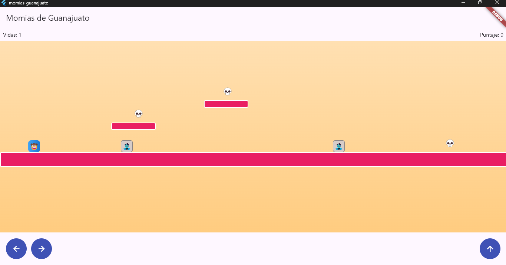

# Momias de Guanajuato

Juego de plataformas hecho con Flutter. Camina y salta para derrotar momias,
recolectar calaveritas y llegar al final del nivel.

## 6. Cómo ejecutar todo

Desde la raíz del proyecto:

1. Ejecuta las pruebas:

   ```bash
   flutter test
   ```

2. Inicia el juego:

   ```bash
   flutter run
   ```

3. Mantén presionados los botones de izquierda o derecha para caminar y el
   botón de arriba para saltar.
4. Salta encima de las momias para derrotarlas, recolecta las calaveritas y
   llega al final del nivel.

> **Estado de pruebas:** en la última ejecución, `flutter test` no pasó
> completamente: 21 pruebas pasaron y se detectaron fallos en dos casos de
> colisión y en la prueba de widget, que referencia `MyApp` en lugar de la
> aplicación actual (`MomiasApp`). El proyecto contiene seis archivos de prueba.

## 7. Checklist de este proyecto TDD

| Verificación | Estado |
| --- | :---: |
| La colisión AABB (`Rectangulo`) se probó de forma aislada antes de usarse en cualquier otra parte. | ✓ |
| `resolverColisionConPiso` usa la posición anterior del personaje, no solo la actual. | ✓ |
| El criterio de *stomp* exige caer y estar en la mitad superior de la momia, no solo intersectar. | ✓ |
| `patrullar()`, la aleatoriedad (`agregarFichaAleatoria`-style) y demás lógica sensible al tiempo son deterministas en las pruebas. | ✓ |
| `MotorJuego.mover()` es el único lugar que decide el orden de física, combate, recolección y meta. | ✓ |
| La interfaz no decide colisiones ni puntajes; solo traduce el estado de `MotorJuego` a píxeles. | ✓ |

## Evidencia

La captura muestra el juego en ejecución, con el personaje, las momias, las
calaveritas, las plataformas y los controles:


